# Entity Relationship Diagram (ERD)
## Fatherman — Unified Commerce & eLearning Platform
**Versi:** 1.0 | **Tanggal:** 18 Mei 2026

---

## 1. ERD DIAGRAM (Mermaid)

```mermaid
erDiagram

    %% ===== AUTH & USER =====
    USERS {
        bigint id PK
        string name
        string email UK
        string phone UK
        string password
        string google_id
        string avatar_url
        enum role "guest|member|cs|admin|super_admin"
        enum status "active|inactive|suspended"
        timestamp email_verified_at
        timestamp last_login_at
        timestamps created_updated_at
    }

    REFRESH_TOKENS {
        bigint id PK
        bigint user_id FK
        string token UK
        string device_info
        timestamp expires_at
        timestamp revoked_at
        timestamps created_updated_at
    }

    %% ===== PRODUCTS =====
    PRODUCTS {
        bigint id PK
        string sku UK
        string name
        text description
        text short_description
        string thumbnail_url
        enum type "physical|digital|ecourse|bundle"
        decimal price
        decimal sale_price
        boolean is_active
        boolean is_repeat_purchase
        integer weight_gram
        json metadata
        timestamps created_updated_at
    }

    PRODUCT_MEDIA {
        bigint id PK
        bigint product_id FK
        enum type "image|video|document"
        string url
        integer sort_order
        timestamps created_updated_at
    }

    PRODUCT_DIGITAL_FILES {
        bigint id PK
        bigint product_id FK
        string file_name
        string file_url
        string file_type
        bigint file_size_bytes
        timestamps created_updated_at
    }

    PRODUCT_BUNDLES {
        bigint id PK
        bigint parent_product_id FK
        bigint child_product_id FK
        integer quantity
    }

    %% ===== CATEGORIES =====
    CATEGORIES {
        bigint id PK
        string name
        string slug UK
        bigint parent_id FK
        timestamps created_updated_at
    }

    PRODUCT_CATEGORIES {
        bigint product_id FK
        bigint category_id FK
    }

    %% ===== OWNERSHIP =====
    PRODUCT_OWNERSHIP {
        bigint id PK
        bigint user_id FK
        string guest_email
        string guest_phone
        bigint product_id FK
        bigint order_id FK
        enum access_status "active|expired|suspended"
        timestamp access_granted_at
        timestamp access_expires_at
        timestamps created_updated_at
    }

    %% ===== ORDERS =====
    ORDERS {
        bigint id PK
        string order_number UK
        bigint user_id FK "nullable - null jika guest"
        string guest_email
        string guest_phone
        string buyer_name
        enum status "pending_payment|paid|processing|shipped|completed|cancelled|refunded"
        decimal subtotal
        decimal shipping_cost
        decimal discount_amount
        decimal tax_amount
        decimal total_amount
        string coupon_code
        json shipping_address
        string courier_name
        string courier_service
        string tracking_number
        text notes_buyer
        text notes_internal
        timestamp paid_at
        timestamp shipped_at
        timestamp completed_at
        timestamp cancelled_at
        timestamps created_updated_at
    }

    ORDER_ITEMS {
        bigint id PK
        bigint order_id FK
        bigint product_id FK
        string product_name "snapshot saat beli"
        decimal product_price "snapshot saat beli"
        integer quantity
        decimal subtotal
        timestamps created_updated_at
    }

    ORDER_STATUS_LOGS {
        bigint id PK
        bigint order_id FK
        bigint changed_by FK "user_id admin/cs"
        enum from_status
        enum to_status
        text note
        timestamps created_updated_at
    }

    ORDER_FOLLOWUP_LOGS {
        bigint id PK
        bigint order_id FK
        bigint created_by FK "user_id cs/admin"
        enum channel "whatsapp|email|phone|internal_note"
        text content
        timestamps created_updated_at
    }

    %% ===== PAYMENTS =====
    PAYMENTS {
        bigint id PK
        bigint order_id FK
        string payment_ref UK "ref dari gateway"
        string gateway "midtrans|xendit|manual"
        enum method "va_bca|va_bri|va_bni|va_mandiri|qris|gopay|ovo|shopeepay|transfer_manual"
        decimal amount
        enum status "pending|success|failed|expired|refunded"
        string va_number
        timestamp expires_at
        json gateway_response "raw response dari gateway"
        timestamp paid_at
        timestamps created_updated_at
    }

    PAYMENT_CALLBACKS {
        bigint id PK
        bigint payment_id FK
        string gateway
        json payload "raw webhook payload"
        boolean is_valid_signature
        boolean is_processed
        timestamps created_updated_at
    }

    %% ===== SHIPPING =====
    SHIPPING_ADDRESSES {
        bigint id PK
        bigint user_id FK "nullable"
        string label "rumah|kantor|dll"
        string recipient_name
        string phone
        string address_line1
        string address_line2
        string city
        string province
        string postal_code
        string rajaongkir_city_id
        boolean is_default
        timestamps created_updated_at
    }

    %% ===== NOTIFICATIONS =====
    NOTIFICATION_LOGS {
        bigint id PK
        bigint user_id FK "nullable"
        string recipient_phone
        string recipient_email
        enum channel "whatsapp|email"
        string template_key
        json variables "data yang dikirim"
        enum status "pending|sent|failed"
        string provider_message_id
        text error_message
        timestamps created_updated_at
    }

    NOTIFICATION_TEMPLATES {
        bigint id PK
        string key UK
        enum channel "whatsapp|email"
        string subject "for email"
        text body_template
        boolean is_active
        timestamps created_updated_at
    }

    %% ===== ECOURSE =====
    COURSES {
        bigint id PK
        bigint product_id FK "link ke produk"
        string title
        text description
        string thumbnail_url
        string instructor_name
        integer total_lessons
        integer estimated_minutes
        boolean is_sequential "lesson harus urut?"
        boolean has_certificate
        timestamps created_updated_at
    }

    COURSE_MODULES {
        bigint id PK
        bigint course_id FK
        string title
        text description
        integer sort_order
        boolean is_published
        timestamps created_updated_at
    }

    COURSE_LESSONS {
        bigint id PK
        bigint module_id FK
        string title
        text description
        enum content_type "video|pdf|text|quiz"
        text content_body "text content atau embed code"
        string video_url
        string video_provider "youtube|vimeo|hosted"
        string file_url "for pdf"
        integer duration_minutes
        integer sort_order
        boolean is_free_preview
        boolean is_published
        timestamps created_updated_at
    }

    COURSE_QUIZZES {
        bigint id PK
        bigint lesson_id FK
        string question
        json options "array pilihan jawaban"
        integer correct_option_index
        text explanation
        integer sort_order
    }

    %% ===== MEMBER PROGRESS =====
    MEMBER_ENROLLMENTS {
        bigint id PK
        bigint user_id FK
        bigint course_id FK
        decimal progress_percent
        bigint last_lesson_id FK
        timestamp enrolled_at
        timestamp completed_at
        timestamps created_updated_at
    }

    MEMBER_LESSON_PROGRESS {
        bigint id PK
        bigint user_id FK
        bigint lesson_id FK
        enum status "not_started|in_progress|completed"
        integer watch_duration_seconds
        timestamp started_at
        timestamp completed_at
        timestamps created_updated_at
    }

    MEMBER_QUIZ_ATTEMPTS {
        bigint id PK
        bigint user_id FK
        bigint quiz_id FK
        json answers
        integer score
        boolean is_passed
        timestamps created_updated_at
    }

    CERTIFICATES {
        bigint id PK
        bigint user_id FK
        bigint course_id FK
        string certificate_number UK
        string file_url
        timestamp issued_at
    }

    %% ===== COUPONS =====
    COUPONS {
        bigint id PK
        string code UK
        enum type "percentage|fixed_amount|free_shipping"
        decimal value
        decimal minimum_purchase
        integer max_uses
        integer used_count
        timestamp expires_at
        boolean is_active
        timestamps created_updated_at
    }

    COUPON_USAGES {
        bigint id PK
        bigint coupon_id FK
        bigint order_id FK
        bigint user_id FK "nullable"
        string guest_email
        timestamps created_updated_at
    }

    %% ===== AUDIT =====
    AUDIT_LOGS {
        bigint id PK
        bigint user_id FK
        string action
        string model_type
        bigint model_id
        json old_values
        json new_values
        string ip_address
        string user_agent
        timestamps created_updated_at
    }

    %% ===== SETTINGS =====
    SETTINGS {
        bigint id PK
        string key UK
        text value
        string group
        timestamps created_updated_at
    }

    %% ===== RELATIONSHIPS =====
    USERS ||--o{ REFRESH_TOKENS : has
    USERS ||--o{ PRODUCT_OWNERSHIP : owns
    USERS ||--o{ ORDERS : places
    USERS ||--o{ SHIPPING_ADDRESSES : has
    USERS ||--o{ MEMBER_ENROLLMENTS : enrolled_in
    USERS ||--o{ MEMBER_LESSON_PROGRESS : tracks
    USERS ||--o{ AUDIT_LOGS : performs
    USERS ||--o{ ORDER_FOLLOWUP_LOGS : creates
    USERS ||--o{ NOTIFICATION_LOGS : receives
    USERS ||--o{ CERTIFICATES : earns

    PRODUCTS ||--o{ PRODUCT_MEDIA : has
    PRODUCTS ||--o{ PRODUCT_DIGITAL_FILES : has
    PRODUCTS ||--o{ PRODUCT_CATEGORIES : belongs_to
    PRODUCTS ||--o{ PRODUCT_BUNDLES : contains
    PRODUCTS ||--o{ PRODUCT_OWNERSHIP : owned_via
    PRODUCTS ||--|| COURSES : linked_to
    PRODUCTS ||--o{ ORDER_ITEMS : ordered_in

    CATEGORIES ||--o{ PRODUCT_CATEGORIES : includes
    CATEGORIES ||--o{ CATEGORIES : parent_of

    ORDERS ||--o{ ORDER_ITEMS : contains
    ORDERS ||--o{ ORDER_STATUS_LOGS : has
    ORDERS ||--o{ ORDER_FOLLOWUP_LOGS : has
    ORDERS ||--o{ PAYMENTS : paid_by
    ORDERS ||--o{ COUPON_USAGES : uses

    PAYMENTS ||--o{ PAYMENT_CALLBACKS : receives

    COURSES ||--o{ COURSE_MODULES : has
    COURSES ||--o{ MEMBER_ENROLLMENTS : enrolls
    COURSES ||--o{ CERTIFICATES : awards

    COURSE_MODULES ||--o{ COURSE_LESSONS : contains
    COURSE_LESSONS ||--o{ COURSE_QUIZZES : has
    COURSE_LESSONS ||--o{ MEMBER_LESSON_PROGRESS : tracked_by

    MEMBER_ENROLLMENTS }o--|| COURSE_LESSONS : last_lesson

    COUPONS ||--o{ COUPON_USAGES : used_by
```



---

## 2. SCHEMA DATABASE (MySQL / MariaDB)

### 2.1 Users & Auth

```sql
CREATE TABLE users (
    id BIGINT UNSIGNED AUTO_INCREMENT PRIMARY KEY,
    name VARCHAR(255) NOT NULL,
    email VARCHAR(255) UNIQUE,
    phone VARCHAR(20) UNIQUE,
    password VARCHAR(255),
    google_id VARCHAR(255) UNIQUE,
    avatar_url VARCHAR(500),
    role ENUM('guest','member','cs','admin','super_admin') NOT NULL DEFAULT 'member',
    status ENUM('active','inactive','suspended') NOT NULL DEFAULT 'active',
    email_verified_at TIMESTAMP NULL,
    last_login_at TIMESTAMP NULL,
    created_at TIMESTAMP DEFAULT CURRENT_TIMESTAMP,
    updated_at TIMESTAMP DEFAULT CURRENT_TIMESTAMP ON UPDATE CURRENT_TIMESTAMP,
    INDEX idx_email (email),
    INDEX idx_phone (phone),
    INDEX idx_role (role),
    INDEX idx_status (status)
) ENGINE=InnoDB DEFAULT CHARSET=utf8mb4 COLLATE=utf8mb4_unicode_ci;

CREATE TABLE refresh_tokens (
    id BIGINT UNSIGNED AUTO_INCREMENT PRIMARY KEY,
    user_id BIGINT UNSIGNED NOT NULL,
    token VARCHAR(500) NOT NULL,
    device_info VARCHAR(500),
    expires_at TIMESTAMP NOT NULL,
    revoked_at TIMESTAMP NULL,
    created_at TIMESTAMP DEFAULT CURRENT_TIMESTAMP,
    updated_at TIMESTAMP DEFAULT CURRENT_TIMESTAMP ON UPDATE CURRENT_TIMESTAMP,
    UNIQUE KEY uk_token (token(255)),
    INDEX idx_user_id (user_id),
    FOREIGN KEY (user_id) REFERENCES users(id) ON DELETE CASCADE
) ENGINE=InnoDB DEFAULT CHARSET=utf8mb4;
```

### 2.2 Products

```sql
CREATE TABLE products (
    id BIGINT UNSIGNED AUTO_INCREMENT PRIMARY KEY,
    sku VARCHAR(100) UNIQUE NOT NULL,
    name VARCHAR(500) NOT NULL,
    description LONGTEXT,
    short_description TEXT,
    thumbnail_url VARCHAR(500),
    type ENUM('physical','digital','ecourse','bundle') NOT NULL DEFAULT 'physical',
    price DECIMAL(15,2) NOT NULL DEFAULT 0,
    sale_price DECIMAL(15,2) NULL,
    is_active TINYINT(1) NOT NULL DEFAULT 1,
    is_repeat_purchase TINYINT(1) NOT NULL DEFAULT 0,
    weight_gram INT UNSIGNED DEFAULT 0,
    metadata JSON,
    created_at TIMESTAMP DEFAULT CURRENT_TIMESTAMP,
    updated_at TIMESTAMP DEFAULT CURRENT_TIMESTAMP ON UPDATE CURRENT_TIMESTAMP,
    INDEX idx_type (type),
    INDEX idx_is_active (is_active),
    FULLTEXT idx_search (name, short_description)
) ENGINE=InnoDB DEFAULT CHARSET=utf8mb4 COLLATE=utf8mb4_unicode_ci;

CREATE TABLE product_ownership (
    id BIGINT UNSIGNED AUTO_INCREMENT PRIMARY KEY,
    user_id BIGINT UNSIGNED NULL,
    guest_email VARCHAR(255) NULL,
    guest_phone VARCHAR(20) NULL,
    product_id BIGINT UNSIGNED NOT NULL,
    order_id BIGINT UNSIGNED NOT NULL,
    access_status ENUM('active','expired','suspended') NOT NULL DEFAULT 'active',
    access_granted_at TIMESTAMP NOT NULL DEFAULT CURRENT_TIMESTAMP,
    access_expires_at TIMESTAMP NULL,
    created_at TIMESTAMP DEFAULT CURRENT_TIMESTAMP,
    updated_at TIMESTAMP DEFAULT CURRENT_TIMESTAMP ON UPDATE CURRENT_TIMESTAMP,
    INDEX idx_user_product (user_id, product_id),
    INDEX idx_guest_email (guest_email),
    INDEX idx_guest_phone (guest_phone),
    INDEX idx_product_id (product_id),
    FOREIGN KEY (user_id) REFERENCES users(id) ON DELETE SET NULL,
    FOREIGN KEY (product_id) REFERENCES products(id)
) ENGINE=InnoDB DEFAULT CHARSET=utf8mb4;
```

### 2.3 Orders & Payments

```sql
CREATE TABLE orders (
    id BIGINT UNSIGNED AUTO_INCREMENT PRIMARY KEY,
    order_number VARCHAR(50) UNIQUE NOT NULL,
    user_id BIGINT UNSIGNED NULL,
    guest_email VARCHAR(255) NULL,
    guest_phone VARCHAR(20) NULL,
    buyer_name VARCHAR(255) NOT NULL,
    status ENUM(
        'pending_payment','paid','processing',
        'shipped','completed','cancelled','refunded'
    ) NOT NULL DEFAULT 'pending_payment',
    subtotal DECIMAL(15,2) NOT NULL DEFAULT 0,
    shipping_cost DECIMAL(15,2) NOT NULL DEFAULT 0,
    discount_amount DECIMAL(15,2) NOT NULL DEFAULT 0,
    tax_amount DECIMAL(15,2) NOT NULL DEFAULT 0,
    total_amount DECIMAL(15,2) NOT NULL DEFAULT 0,
    coupon_code VARCHAR(50) NULL,
    shipping_address JSON NULL,
    courier_name VARCHAR(100) NULL,
    courier_service VARCHAR(100) NULL,
    tracking_number VARCHAR(200) NULL,
    notes_buyer TEXT NULL,
    notes_internal TEXT NULL,
    paid_at TIMESTAMP NULL,
    shipped_at TIMESTAMP NULL,
    completed_at TIMESTAMP NULL,
    cancelled_at TIMESTAMP NULL,
    created_at TIMESTAMP DEFAULT CURRENT_TIMESTAMP,
    updated_at TIMESTAMP DEFAULT CURRENT_TIMESTAMP ON UPDATE CURRENT_TIMESTAMP,
    INDEX idx_status (status),
    INDEX idx_user_id (user_id),
    INDEX idx_guest_email (guest_email),
    INDEX idx_guest_phone (guest_phone),
    INDEX idx_created_at (created_at),
    FOREIGN KEY (user_id) REFERENCES users(id) ON DELETE SET NULL
) ENGINE=InnoDB DEFAULT CHARSET=utf8mb4 COLLATE=utf8mb4_unicode_ci;

CREATE TABLE payments (
    id BIGINT UNSIGNED AUTO_INCREMENT PRIMARY KEY,
    order_id BIGINT UNSIGNED NOT NULL,
    payment_ref VARCHAR(255) UNIQUE NOT NULL,
    gateway ENUM('midtrans','xendit','manual') NOT NULL,
    method ENUM(
        'va_bca','va_bri','va_bni','va_mandiri',
        'qris','gopay','ovo','shopeepay','transfer_manual'
    ) NOT NULL,
    amount DECIMAL(15,2) NOT NULL,
    status ENUM('pending','success','failed','expired','refunded') NOT NULL DEFAULT 'pending',
    va_number VARCHAR(100) NULL,
    expires_at TIMESTAMP NULL,
    gateway_response JSON NULL,
    paid_at TIMESTAMP NULL,
    created_at TIMESTAMP DEFAULT CURRENT_TIMESTAMP,
    updated_at TIMESTAMP DEFAULT CURRENT_TIMESTAMP ON UPDATE CURRENT_TIMESTAMP,
    INDEX idx_order_id (order_id),
    INDEX idx_status (status),
    FOREIGN KEY (order_id) REFERENCES orders(id) ON DELETE CASCADE
) ENGINE=InnoDB DEFAULT CHARSET=utf8mb4;
```

### 2.4 eCourse

```sql
CREATE TABLE courses (
    id BIGINT UNSIGNED AUTO_INCREMENT PRIMARY KEY,
    product_id BIGINT UNSIGNED NOT NULL,
    title VARCHAR(500) NOT NULL,
    description LONGTEXT,
    thumbnail_url VARCHAR(500),
    instructor_name VARCHAR(255),
    total_lessons INT UNSIGNED DEFAULT 0,
    estimated_minutes INT UNSIGNED DEFAULT 0,
    is_sequential TINYINT(1) NOT NULL DEFAULT 0,
    has_certificate TINYINT(1) NOT NULL DEFAULT 1,
    created_at TIMESTAMP DEFAULT CURRENT_TIMESTAMP,
    updated_at TIMESTAMP DEFAULT CURRENT_TIMESTAMP ON UPDATE CURRENT_TIMESTAMP,
    FOREIGN KEY (product_id) REFERENCES products(id)
) ENGINE=InnoDB DEFAULT CHARSET=utf8mb4 COLLATE=utf8mb4_unicode_ci;

CREATE TABLE course_lessons (
    id BIGINT UNSIGNED AUTO_INCREMENT PRIMARY KEY,
    module_id BIGINT UNSIGNED NOT NULL,
    title VARCHAR(500) NOT NULL,
    description TEXT,
    content_type ENUM('video','pdf','text','quiz') NOT NULL DEFAULT 'video',
    content_body LONGTEXT NULL,
    video_url VARCHAR(500) NULL,
    video_provider ENUM('youtube','vimeo','hosted') NULL,
    file_url VARCHAR(500) NULL,
    duration_minutes INT UNSIGNED DEFAULT 0,
    sort_order INT UNSIGNED NOT NULL DEFAULT 0,
    is_free_preview TINYINT(1) NOT NULL DEFAULT 0,
    is_published TINYINT(1) NOT NULL DEFAULT 1,
    created_at TIMESTAMP DEFAULT CURRENT_TIMESTAMP,
    updated_at TIMESTAMP DEFAULT CURRENT_TIMESTAMP ON UPDATE CURRENT_TIMESTAMP,
    INDEX idx_module_id (module_id),
    INDEX idx_sort_order (sort_order),
    FOREIGN KEY (module_id) REFERENCES course_modules(id) ON DELETE CASCADE
) ENGINE=InnoDB DEFAULT CHARSET=utf8mb4 COLLATE=utf8mb4_unicode_ci;

CREATE TABLE member_lesson_progress (
    id BIGINT UNSIGNED AUTO_INCREMENT PRIMARY KEY,
    user_id BIGINT UNSIGNED NOT NULL,
    lesson_id BIGINT UNSIGNED NOT NULL,
    status ENUM('not_started','in_progress','completed') NOT NULL DEFAULT 'not_started',
    watch_duration_seconds INT UNSIGNED DEFAULT 0,
    started_at TIMESTAMP NULL,
    completed_at TIMESTAMP NULL,
    created_at TIMESTAMP DEFAULT CURRENT_TIMESTAMP,
    updated_at TIMESTAMP DEFAULT CURRENT_TIMESTAMP ON UPDATE CURRENT_TIMESTAMP,
    UNIQUE KEY uk_user_lesson (user_id, lesson_id),
    INDEX idx_user_id (user_id),
    INDEX idx_lesson_id (lesson_id),
    FOREIGN KEY (user_id) REFERENCES users(id) ON DELETE CASCADE,
    FOREIGN KEY (lesson_id) REFERENCES course_lessons(id) ON DELETE CASCADE
) ENGINE=InnoDB DEFAULT CHARSET=utf8mb4;

CREATE TABLE certificates (
    id BIGINT UNSIGNED AUTO_INCREMENT PRIMARY KEY,
    user_id BIGINT UNSIGNED NOT NULL,
    course_id BIGINT UNSIGNED NOT NULL,
    certificate_number VARCHAR(100) UNIQUE NOT NULL,
    file_url VARCHAR(500),
    issued_at TIMESTAMP NOT NULL DEFAULT CURRENT_TIMESTAMP,
    UNIQUE KEY uk_user_course (user_id, course_id),
    FOREIGN KEY (user_id) REFERENCES users(id) ON DELETE CASCADE,
    FOREIGN KEY (course_id) REFERENCES courses(id) ON DELETE CASCADE
) ENGINE=InnoDB DEFAULT CHARSET=utf8mb4;
```

### 2.5 Audit Log

```sql
CREATE TABLE audit_logs (
    id BIGINT UNSIGNED AUTO_INCREMENT PRIMARY KEY,
    user_id BIGINT UNSIGNED NULL,
    action VARCHAR(100) NOT NULL,
    model_type VARCHAR(100) NOT NULL,
    model_id BIGINT UNSIGNED NULL,
    old_values JSON NULL,
    new_values JSON NULL,
    ip_address VARCHAR(45) NOT NULL,
    user_agent VARCHAR(500),
    created_at TIMESTAMP DEFAULT CURRENT_TIMESTAMP,
    INDEX idx_user_id (user_id),
    INDEX idx_model (model_type, model_id),
    INDEX idx_created_at (created_at)
) ENGINE=InnoDB DEFAULT CHARSET=utf8mb4;
```

---

## 3. INDEXING STRATEGY

| Tabel | Column | Jenis Index | Alasan |
|---|---|---|---|
| users | email, phone | UNIQUE | Login & dedup check |
| orders | status, created_at | COMPOSITE | Filter dashboard |
| orders | guest_email, guest_phone | INDEX | Ownership check guest |
| product_ownership | user_id, product_id | COMPOSITE | Cek kepemilikan |
| member_lesson_progress | user_id, lesson_id | UNIQUE | Satu record per user per lesson |
| payments | payment_ref | UNIQUE | Idempotency webhook |
| audit_logs | created_at | INDEX | Pruning & range query |

---

## 4. NAMING CONVENTIONS

- Tabel: `snake_case`, plural
- Kolom: `snake_case`
- Primary Key: selalu `id` (BIGINT UNSIGNED AUTO_INCREMENT)
- Foreign Key: `{table_singular}_id` (contoh: `user_id`, `order_id`)
- Timestamps: selalu ada `created_at` dan `updated_at`
- Soft delete (opsional): gunakan `deleted_at` (Laravel SoftDeletes)
- Enum values: `snake_case` huruf kecil
- Boolean: prefix `is_` atau `has_`

---

## 5. DATA RETENTION POLICY

| Tabel | Retention | Alasan |
|---|---|---|
| audit_logs | 2 tahun | Compliance & forensik |
| payment_callbacks | 1 tahun | Reconciliation |
| notification_logs | 6 bulan | Troubleshooting |
| refresh_tokens | Auto-expire | TTL field |
| member_lesson_progress | Permanent | Rekam jejak belajar |
| orders | Permanent | Laporan keuangan |
